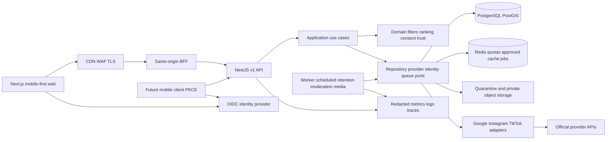
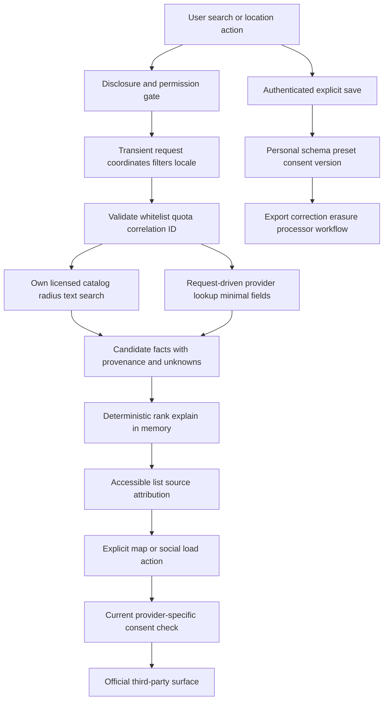

# Architecture proposal

Status: Phase 0 design. No deployed components exist.

## Boundaries and stack

Use a modular monolith API and worker rather than early microservices. NestJS supplies DI and HTTP presentation; domain modules remain plain TypeScript with no framework imports. Next.js supplies responsive rendering, localization and a BFF that keeps browser OAuth tokens on the server. Managed PostgreSQL provides transactions and PostGIS radius operations over independently licensed data. Redis is infrastructure only, never a domain dependency or a blanket provider-content cache. Object storage accepts only quarantined licensed uploads after validation. The proposed identity provider owns password registration/reset, passkeys, TOTP and OIDC; Aroundate does not implement a parallel password system.

Sites hosting was considered. Its Cloudflare Worker runtime and storage bindings are useful for other website scopes, but do not directly implement this requested containerized NestJS/PostGIS architecture. No Site was registered or published. This is an architecture choice for approval, not removal of hosting requirements.

Proposed future source layout: `apps/web`, `apps/api`, `apps/worker`, `packages/domain`, `packages/contracts`, `packages/config`, `db/migrations`, `infra`, `tests`. No application directories are created before approval. Each feature module separates `domain`, `application`, `infrastructure`, `presentation`.

## Ports and patterns

| Boundary | Pattern and purpose |
| --- | --- |
| Place/filter/preset persistence | Repository; parameterized SQL and explicit projections prevent infrastructure leakage. |
| Consent, review and DSR writes | Unit of Work for atomic domain state, audit record and outbox event. |
| Ranking | Strategy with immutable normalized candidate input; both strategies share validated facts. |
| Providers | Adapter + anti-corruption mapping; factory selects an allowlisted provider; external schemas are validated before mapping. |
| Dependency selection | DI at composition root; sandbox adapters use exactly the same ports. |
| External failures | Deadline, Retry, Circuit Breaker and per-provider Bulkhead; no retries for validation or non-idempotent writes. |
| Background side effects | Transactional outbox with at-least-once delivery and consumer deduplication; no distributed transaction claim. |
| Duplicate client writes | Owner/route-scoped idempotency records with body hash and unique key. |
| Browser authentication | BFF retains tokens server-side, browser gets an opaque secured session cookie. |

Do not introduce event sourcing, Kubernetes, distributed search engines, partitions or read replicas before measured need. Database relation trees, dynamic criteria vocabulary and DB-configured limits avoid hard-coded catalog assumptions. Filters and ranking are reusable by later clients.

## Data flow and privacy trust boundaries

Trust boundaries: untrusted browser/client; CDN/BFF; application network; private database/objects/KMS; separate identity processor; third-party internet; administrative tools and CI supply chain. TLS applies across boundaries; no public DB or Redis. User coordinates, queries and source review text are excluded from logs and traces. A place's publicly licensed coordinate is not the user's search coordinate.

## Provider data versus own data

Store provider ID association long-term when allowed. Display Google content request-time, with provider attribution, and use Google maps for Google Places content. Do not create the native full-text index from Google names/reviews/addresses or run an offline mirror. Provider field storage policies require a versioned legal permission, fields, purpose and expiry; default denied. Background jobs process own content, retention and authorized provider metadata only; no background speculative Places prefetch.

## Configuration and sandbox

Future `.env.example` includes placeholders for API origin allowlist, OIDC issuer/audience, approved JWKS/algorithm, DB/Redis/object endpoints, secret references, KMS key reference, provider-enabled flags, CRC/USD, limits, retention and legal-contact references. Public Maps key is intentionally visible but API/referrer restricted and quota-limited; server keys and OAuth credentials never enter bundles. Validate configuration at startup and fail closed for enabled features missing dependencies.

Sandbox mode uses explicitly fictional venues, coordinates, authors, reviews and licensed/local generated fixtures; fixtures never impersonate Google/Instagram/TikTok live data. Maps/embeds show a labeled offline alternative until permitted official loading. No paid keys, network, tracking or real personal data required. Production startup rejects sandbox identity bypasses and demo credentials.

## Quality rationale

Hexagonal boundaries support testable ranking, replacement of constrained providers and graceful degradation. Containers/environment config support 12-factor deployment; transactions preserve consent/deletion consistency. See [quality plan](quality-plan.md) for measurable ISO/IEC 25010 targets; full normative ISO mappings require access to approved editions and organizational audit evidence, rather than a claim of ISO certification from source code.
