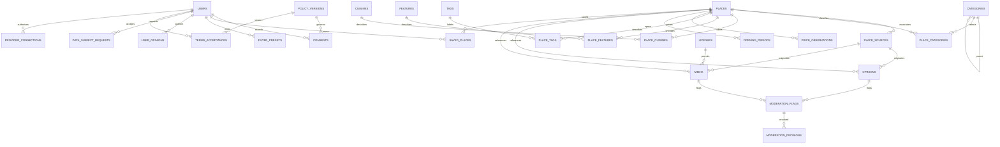

# Logical data model and ERD

Proposed PostgreSQL model, 3NF unless explicitly noted. This is not a migration or an EXPLAIN result. Source-storage rights apply before a row can be inserted.

The dictionary below is authoritative; the overview ERD omits auxiliary joins for readability. Physical schema and every FK/index/check will be finalized in reversible Phase 1 migrations.

## Schema dictionary

| Schema/table | Main attributes, relationships and constraints |
| --- | --- |
| `catalog.places` | UUIDv7 PK, independently sourced name/address, country CHAR(2), timezone, licensed geography(Point,4326), website/phone, provenance_id FK, created_at/updated_at/deleted_at TIMESTAMPTZ; no wholesale copied Places data. Website scheme/domain validation; geography bounds. |
| `catalog.provenance` | ID, provider enum/reference, evidence URI, author, license FK, acquired_at, permitted_fields, policy_version FK; no assumed public-domain status. |
| `catalog.providers` / `provider_policies` | Provider identity; versioned field/purpose storage permissions, expiry ceiling and deletion rules. Approval required before policy allows any caching. |
| `catalog.place_sources` | UUID PK, place FK, provider FK, external_id, last_synced/checked timestamp nullable, UNIQUE(provider,external_id). Durable IDs only when permitted; payloads are not stored here. Provider checks mark availability without copying content. |
| `catalog.provider_field_cache` | Optional strictly authorized field/value, provenance FK, expires_at; unique source+field+policy. Initially disabled for Google text/reviews/photos. TTL deletion and non-read-after-expiry enforced at repository boundary. |
| `catalog.categories` / `category_translations` | UUID PK, parent_id FK nullable, stable unique slug; locale PK pair and name; no self-parent and deferred cycle check. Seed coffee, restaurants, active/adventure; managed tree not a compiled enum. |
| `catalog.cuisines` / `cuisine_translations` | UUID PK, unique slug, translations; extensible cuisines including requested seed types. |
| `place_categories` / `place_cuisines` | Composite place/entity PK, provenance FK, evidence_checked_at; restrictive catalog delete or audited tombstone. |
| `features` / `place_features` | Dietary/accessibility feature taxonomy, translation table, value true/false/unknown, provenance and observation date; explicit state avoids assuming accessibility from an absent field. |
| `tags` / `place_tags` | Tag vocabulary and translations; composite PK plus provenance/editorial actor FK, evidence and observation date; user tagging enters moderation rather than instant factual assertion. |
| `price_levels` / `price_observations` | Source-defined level meanings; place FK, NUMERIC(18,4) amount >=0 nullable, ISO currency FK, basis enum (per-person/menu-item/activity), level FK nullable, observation/expiry dates, provenance; require amount+currency+basis together and at least amount or level. |
| `fx_rates` / `currencies` | Currency code PK, decimal precision, base/quote, NUMERIC positive rate, valid_at, approved source; unique pair/time. Label converted estimates; no direct binary float money. |
| `opening_periods` / `opening_exceptions` | Place FK, local weekday/time intervals and overnight end-day offset; closure/exception calendar; provenance. Place timezone converts fixed UTC instant. Preserve distinction unknown vs closed. |
| `catalog.opinions` | Reference ID, place_source FK nullable/native source, source author as provided, source date nullable, original link, attribution, license/provenance; nullable rating bounded 0–5. External text/author/date only stored when specifically licensed; Google opinions remain transient presentation DTOs, not these rows. |
| `content.user_opinions` | opinion FK/PK, author user FK, original text, verified_account_at, incentive disclosure, terms/license version, created_at, edit history reference, publication/moderation state. Native rating average computed from eligible visible opinions, not positive-only reviews. |
| `content.media` / `media_attributions` | Place/source FKs, owner FK nullable, private storage key or permitted provider reference, sniffed MIME, byte count, dimensions, scan/strip status, source/author/date nullable, license FK, source link, alt_text, takedown state. Must have provenance and license before publication. Not an external-image mirror. |
| `content.licenses` | License identifier/version, full grant/evidence and validity, allowed uses, attribution conditions; user upload grant recorded separately from consent. |
| `privacy.users` | UUIDv7 PK, unique OIDC issuer+subject, encrypted email/display name where necessary, verified status, age-attestation date, created_at/deleted_at/erase_after. No DOB/gender/romantic preference fields. Passwords reside only at identity provider. |
| `privacy.consents` / `policy_versions` | Append-only consent events: nullable account FK or rotating anonymous proof identifier, purpose, grant/withdraw/reject, text/policy version FK, timestamp, proof hash and source; never full IP or unrelated device fingerprint. Latest state materialized only as documented projection. |
| `privacy.terms_acceptances` | Account FK, terms version FK, affirmative click-wrap event/timestamp; separate from optional consent. |
| `privacy.saved_places` | Composite user+place PK, saved_at; user FK scoped in every query. Provider-only places may create UUID shell with permitted place ID, not prohibited copied detail fields. |
| `privacy.filter_presets` | UUID PK, owner FK, name, versioned validated JSON filter document, optional encrypted saved center only with explicit save-location event FK, timestamps. Unique(owner,name). JSON is a value object with schema rejection of unknown fields; no entity relations hidden inside it. |
| `privacy.provider_connections` | Owner FK, provider FK, authorized scopes, encrypted token references/key version, expiry/revocation; tokens not stored unencrypted or returned to client. |
| `privacy.data_subject_requests` / `dsr_tasks` | Owner FK, type, verification state, legal jurisdiction, deadline, status; child tasks for DB, identity, objects, processors, exports and backup expiry. Private export object expires after 24 hours. |
| `trust.moderation_flags` | Exactly one opinion FK, media FK or tag-assertion FK, reporter FK nullable, heuristic/manual reason, evidence reference, state and timestamp. CHECK exactly one target; anonymous abuse reports protected by quotas, not proof of wrongdoing. |
| `trust.moderation_decisions` / `appeals` | Flag FK, authorized moderator actor, reason/legal basis, action, evidence and notice; appeal relation. Author notice except legally prohibited; no deletion solely for being negative. |
| `ops.search_logs` | Optional opt-in, coarse aggregated event counts only; no query/address/coordinate/account identifier; day/locale/latency bucket and short retention. No cross-site identifiers. |
| `ops.audit_log` | Append-only structured action/event ID, pseudonymous actor, target opaque ID, time, result, correlation ID and hash-chain segment; no tokens/review text/location. Identity linkage separated and erased when no lawful retention applies. Export to tamper-resistant sink. |
| `ops.idempotency_records` | Owner/session scope hash, route, key hash, request hash, outcome reference, TTL; unique scope+route+key. No long-term request body/provider payload. |
| `ops.outbox` / `job_receipts` | Atomic event ID/type/minimal payload, attempts and next delivery; unique event+consumer deduplication receipts; sensitive data references instead of payload duplication. |
| `ops.configuration` | Versioned validated operational config including radius/limits/legal module/feature flags; privileged change audit; not a secret vault. |

Shared dictionary reference tables enforce valid currencies/countries/languages where appropriate; BCP 47 locales use allowlisted launch values with extensible validated registry. Every required relation has PK/FK, nullable fields have an explicit reason, all dates are UTC TIMESTAMPTZ; local hours/timezones are explicitly separate. UUIDv7 is generated by a reviewed library/service, not by a guessed SQL function; public IDs are not authorization secrets and can leak approximate creation time.

## Access and database roles

Separate migration role (DDL only during release), application role (needed CRUD only, no DROP/DDL, no ownership/BYPASSRLS), scoped worker role and read-only reporting role limited to anonymized views. Personal tables use RLS with `FORCE ROW LEVEL SECURITY`, transaction-local authenticated subject and restrictive owner policies; authorization remains in application too. Connection pools must reset all context. Moderation/admin scopes use separate audited permissions. Reporting cannot read privacy schema or consent proofs.

Consent/review/preset writes and audit/outbox insert use one Unit of Work; native averages update transactionally if a measured projection is later introduced. Consent latest-state projection and search-vector columns are deliberate derived denormalizations, with source-of-truth events/content, versioning and rebuild jobs. No other denormalization is approved without measurements.

## Index and query-plan plan

GiST on licensed place geography for `ST_DWithin`; GIN on owned Spanish/English tsvectors and normalized-name trigram index. Normalize unaccent at write time with a versioned algorithm rather than claiming an unsafe mutable SQL function is immutable. B-tree source external IDs, category parent, joins, user+created_at+UUID keyset indexes, moderation state+created_at and expiry/deletion dates. Include source permission predicates before queries. Review proposed indexes against `EXPLAIN (ANALYZE, BUFFERS)` with synthetic cardinalities, p95 budget and write cost; no claim of existing EXPLAIN evidence.

Example logical query: parameterized center/radius + `ST_DWithin(location,$center,$radius)` + EXISTS joins per selected taxonomy + whitelisted native search predicates; select projections and batched related facts, not one query per result. Ranking occurs after bounded candidate admission. All user-owned statements include authenticated owner, never request-supplied owner IDs.

## Retention, encryption and migrations

See [privacy inventory](privacy-legal.md) for proposed periods. Deletion marks account and dependent content unavailable immediately, revokes sessions/connections, queues hard deletion, then reconciles objects/identity/processors. Backups expire on schedule; immutable backups cannot be rewritten arbitrarily. Restore occurs isolated and applies erasure tombstones before any traffic. Tombstones retain minimal hashed identifiers with documented lawful basis/time limit, not full user records forever.

Managed AES-256 at rest and KMS-wrapped field encryption with per-field associated data/key versions, TLS 1.2+ in transit; access to decrypt is separately authorized. Rotation supports re-encryption and recovery tests. Backups are encrypted, immutable, isolated and restore-tested; proposed RPO 15m/RTO 4h.

Phase 1 migrations have increasing versions, paired up/down operations and tests from empty schema and previous release. Drops/removal of personal data cannot promise lossless rollback; use expand/migrate/contract, backups and forward-fix strategy for destructive changes, require an explicit release review. Native synthetic seed has the complete category tree and no real PII or fake provider attributions.
